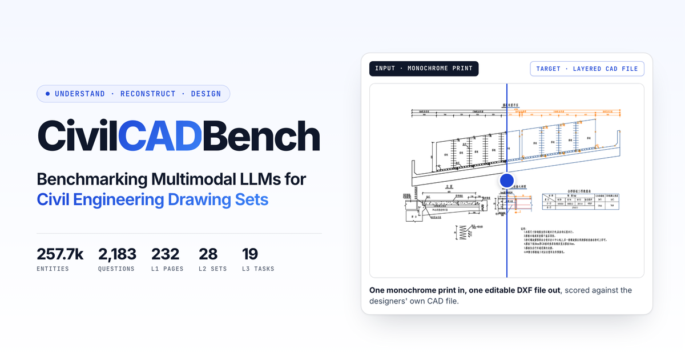
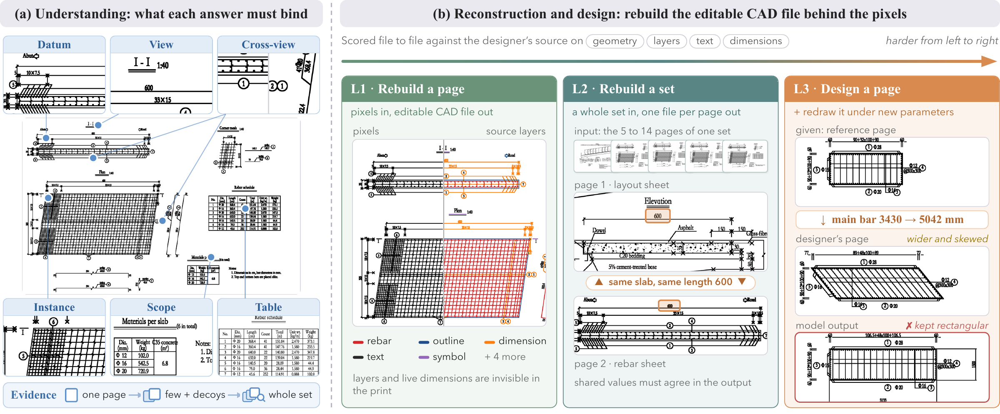
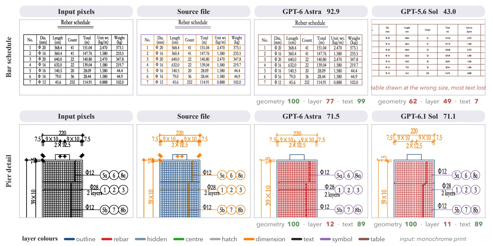
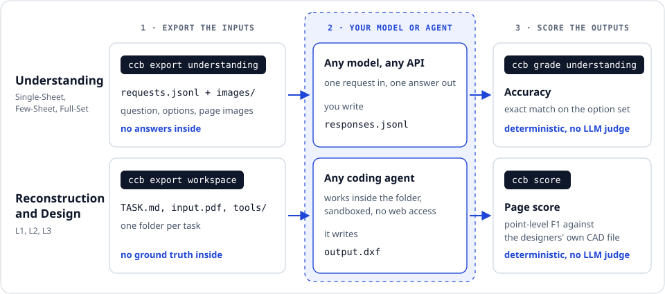

<p align="center">
  <a href="https://agenticivil.com/civilcadbench/">
    
  </a>
</p>

<h3 align="center">
  Benchmarking Multimodal LLMs for Understanding, Reconstructing,<br>and Designing Civil Engineering Drawing Sets
</h3>

<p align="center">
  <a href="https://agenticivil.com/civilcadbench/"></a>
  <a href="https://agenticivil.com/civilcadbench/#results"></a>
  <a href="https://agenticivil.com/civilcadbench/sample/"></a>
  
  
</p>

<p align="center">
  <b>English</b> | <a href="README_zh.md">简体中文</a>
</p>

A printed drawing keeps the lines and loses the file behind them: the layers, the dimension entities, and the link
between a printed number and the object it describes. CivilCADBench measures how much of that a model can recover
from real civil engineering drawing sets, in three tasks of rising difficulty.

<p align="center">
  
</p>
<p align="center"><sub><b>(a)</b> Understanding: every answer binds a number on the page to what it belongs to. <b>(b)</b> Reconstruction and design: the model returns the editable CAD file behind the pixels.</sub></p>

| Task | The model gets | The model returns | Size | Scored by |
|---|---|---|---|---|
| **Understanding** | page images of one sheet, a few sheets or a whole set, and a question | the set of correct options | 1,800 + 383 questions | exact match |
| **Reconstruction** L1 / L2 | a monochrome print of one page / of a whole set | one layered DXF file per page | 232 pages / 28 sets | point-level F1 against the designers' own CAD file |
| **Design** L3 | a reference page with its CAD file, and the rest of the set | a new page as a DXF file | 19 tasks | recall of the values that had to change |

Every score is computed by a deterministic program. No model acts as a judge.

## Results

| Model | L1 page score | L1 layer F1 | L2 set score | L3 design recall | Single-Sheet | Few-Sheet | Full-Set |
|---|---:|---:|---:|---:|---:|---:|---:|
| GPT-6 Astra | **91.2** | 59.9 | **87.8** | 47.9 | **93.3** | **95.3** | **94.5** |
| GPT-6.1 Sol | 90.4 | 58.9 | 85.9 | **49.1** | 91.5 | 92.2 | 89.7 |
| GPT-5.6 Sol | 59.8 | 40.8 | 36.6 | 40.3 | 72.2 | 75.5 | 69.4 |
| DeepSeek-V4.1-Flash | 81.3 | 63.2 | 55.4 | 37.8 | 60.4 | 63.8 | 58.7 |
| GLM-5.3-Flash | 76.1 | **70.8** | 47.2 | 19.2 | 57.4 | 60.2 | 52.8 |
| Qwen3.8-27B | 36.2 | 30.1 | 14.5 | 6.3 | 58.2 | 61.4 | 53.6 |
| Qwen3.5-9B | 5.6 | 1.8 | 0.0 | 0.0 | 34.3 | 43.1 | 8.2 |

On single pages the best model reaches a geometry F1 of 95.5 and a layer-aware F1 of 59.9: it traces the drawing and
does not recover the file. All columns and the case studies are on the
[leaderboard](https://agenticivil.com/civilcadbench/#results).

<p align="center">
  
</p>
<p align="center"><sub>Two L1 pages; colours are layers, the number after a model name is its page score. Both GPT-6 models redraw the pier detail line for line (geometry F1 100), but few of their lines carry the layer of the source file (layer-aware F1 12 and 11).</sub></p>

## Quickstart

```bash
git clone https://github.com/AgentiCivil/CivilCADBench
cd CivilCADBench
pip install -e .
```

Python 3.12 or later is needed. This repository ships a sample of the benchmark (60 questions, 2 multi-sheet units, 6 L1 pages, 1 L2 set, 1 L3 task),
so everything below runs right after the clone. Check the installation by scoring the ground truth against itself:

```bash
ccb selfcheck
# reconstruction  8/8 tasks at 100.0 with the ground truth as output
# understanding   132/132 gold answers pass, 132/132 perturbed answers fail
```

## Evaluate your model or agent

CivilCADBench never calls your model. It hands you the inputs as files, you hand back the outputs as files, and the
scorer does the rest. Any model behind any API and any agent framework fits, as long as it can read and write files.

<p align="center">
  
</p>

### Understanding: one answer per question

```bash
ccb export understanding --tier single --out requests/
```

`requests/requests.jsonl` holds one request per line and no answers (shown here on several lines):

```json
{
  "id": "SS-01",
  "kind": "item",
  "tier": "single",
  "system": "...",
  "prompt": "...",
  "images": ["images/SS-01.png"]
}
```

Send each request to your model and write its final text to `responses.jsonl`:

```json
{"id": "SS-01", "response": "... 答案：A,C"}
```

```bash
ccb grade understanding --tier single responses.jsonl
# prints JSON: items, answered, correct, accuracy, and accuracy by binding type
```

`--tier` is `single`, `few` or `full`. [`examples/openai_compatible.py`](examples/openai_compatible.py) does the
middle step for any OpenAI-compatible endpoint; for another API, replace one function in it.

### Reconstruction and design: one workspace per task

```bash
ccb export workspace --level L1 --out runs/my-agent
```

This creates one folder per task. A folder holds what the agent may see and nothing else:

```
runs/my-agent/L1-easy-01/
  TASK.md            the task statement: coordinates, the nine layers, what to deliver
  input.pdf          the monochrome print
  tools/             render_preview.py, to plot a DXF the way the input was plotted
```

Start your agent inside the folder with the fixed prompt in [`docs/PROTOCOL.md`](docs/PROTOCOL.md). It delivers
`output.dxf` (L1, L3) or `output/page_NN.dxf` (L2). Then score the whole run:

```bash
ccb score runs/my-agent
# writes runs/my-agent/summary.json: page score, geometry / layer / text / dimension F1,
# shared-value recall (L2), design recall (L3)
```

A task without a valid output scores 0. [`examples/`](examples) has a launcher for Codex CLI and a container launcher
for Codex CLI and Claude Code that cuts the network and applies the limits below.

### Protocol for comparable numbers

| Rule | Setting |
|---|---|
| Workspace | a fresh copy per task; one run per task and model; the agent submits once |
| Outside the workspace | the source CAD file, the ground truth and the scorer |
| Reasoning effort | high, for every model |
| Network | none, apart from the model endpoint; no web search |
| Sandbox | 8 CPUs, 16 GB of memory, 1024 processes, non-root |
| Time limit | 2 hours for L1 and L3, 6 hours for L2; at the limit, the files in the workspace are scored |
| Reruns | only after an infrastructure failure, never after a low score |
| Understanding | Single-Sheet and Few-Sheet in one turn; in Full-Set the model opens the pages of the set with tools |

Details and the exact prompts: [`docs/PROTOCOL.md`](docs/PROTOCOL.md).

## Data

| | In this repository | Full benchmark |
|---|---|---|
| Single-Sheet questions | 60 | 1,800 |
| Few-Sheet and Full-Set questions | 10, with 62 probes | 383 and 330 |
| L1 pages | 6 | 232 |
| L2 sets | 1 (7 pages) | 28 |
| L3 tasks | 1 | 19 |

The full benchmark will be published on Hugging Face. Drawings, questions and task statements are in Chinese, the
language of the source drawing sets; the [sample viewer](https://agenticivil.com/civilcadbench/sample/) shows an
English translation next to every question.

- [`docs/PROTOCOL.md`](docs/PROTOCOL.md): the files exchanged with a model or an agent, the prompts and the rules
- [`docs/DATA.md`](docs/DATA.md): layout and file formats of items, parents, probes and tasks; de-identification
- [`docs/SCORING.md`](docs/SCORING.md): the scorers one by one, the columns of `ccb score`, and the fault-injection test
- [`SAMPLING.md`](SAMPLING.md): how the sample was drawn

## Repository layout

```
civilcadbench/     the ccb command line
code/              the scorers, as used for the paper
examples/          model and agent adapters, container sandbox
data/              the sample
docs/              protocol, data formats, scoring
index.html         offline viewer of the sample (uses viewer/ and data/)
results/           fault-injection scores of the six sample pages
```

## Citation

The citation will be added with the paper.

## Contact

Questions and bug reports: please open an [issue](https://github.com/AgentiCivil/CivilCADBench/issues).
