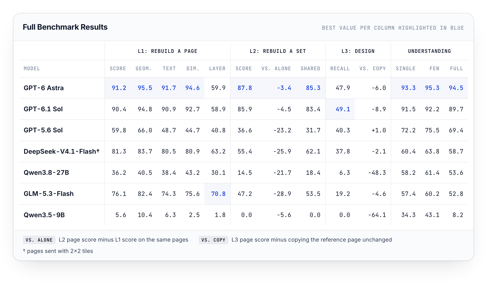

<p align="center">
  <a href="https://agenticivil.com/civilcadbench/">
    
  </a>
</p>

<h3 align="center">
  Benchmarking Multimodal LLMs for Understanding, Reconstructing,<br>and Designing Civil Engineering Drawing Sets
</h3>

<p align="center">
  <a href="https://agenticivil.com/civilcadbench/"></a>
  <a href="https://agenticivil.com/civilcadbench/#results"></a>
  <a href="https://agenticivil.com/civilcadbench/sample/"></a>
  <a href="https://huggingface.co/datasets/AgentiCivil/CivilCADBench"></a>
  <a href="https://arxiv.org/abs/2611.28853"></a>
</p>

<p align="center">
  <b>English</b> | <a href="README_zh.md">简体中文</a>
</p>

A printed drawing shows lines and text, but not the layers, the dimension entities or which object each printed value
refers to; these are kept in the designers' CAD file. CivilCADBench tests how much of this a model can recover, using
real civil engineering drawing sets and three tasks of rising difficulty: understanding, reconstruction and design.

<p align="center">
  
</p>
<p align="center"><sub><b>(a)</b> Understanding: each question asks which object a printed value belongs to. <b>(b)</b> Reconstruction and design: the model returns an editable CAD file (DXF).</sub></p>

CivilCADBench has **2,183 understanding questions** (1,800 on one sheet, 383 across several sheets), **232 pages** and
**28 sets** to reconstruct, and **19 design tasks**.

Every score is computed by a deterministic program. No model acts as a judge.

## Quickstart

Python 3.12 or later is needed. The agent tasks also need Docker.

```bash
git clone https://github.com/AgentiCivil/CivilCADBench
cd CivilCADBench
pip install -e .
# check the installation: the ground truth, scored as an output, gets 100
ccb selfcheck
# get the full benchmark from Hugging Face: about 5.7 GB in 13,000 files
ccb download
```

The repository carries a small sample of the benchmark in `data/`. Before `ccb download`, every command runs on that
sample, which is enough to try the steps below. After it, every command uses the full benchmark. `ccb` prints which of
the two it is using.

## Evaluate a model on the understanding tasks

`ccb run understanding` sends every question to an OpenAI-compatible endpoint, grades the answers and prints the
accuracy.

```bash
export OPENAI_API_KEY=...
ccb run understanding --tier all --model <model> \
    --base-url https://<host>/v1 --out runs/<name>
```

`--tier` is `single`, `few` or `full`; `all` runs the three one after another.

| Tier | The model gets | It answers |
|---|---|---|
| `single` | one page and one question | in one turn |
| `few` | the pages a question needs, mixed with similar pages of the same set | in one turn |
| `full` | a whole drawing set | over several turns: it opens pages with the `view_page` tool and can use `calculate` |

A run that stops can be started again with the same command; finished requests are kept. `--limit 20` answers only
the first 20 requests of each tier, for a first try. `--extra '{"reasoning_effort": "high"}'` adds fields to every
request.

By default a question of the `full` tier gets 16 model turns, 24 page views and 65,536 generated tokens. When the
model zooms in, `ccb` cuts the view out of the released page image, whereas our runs rendered it from the vector
drawing. A zoomed view therefore shows less detail, and Full-Set accuracy from `ccb` is not directly comparable with
the results table.

## Evaluate an agent on the reconstruction and design tasks

`ccb run agent` creates one workspace per task, starts a coding agent in each workspace and scores the DXF files it
delivers. Each agent runs in a container that can reach only the model endpoint. Build the two images once:

```bash
cd examples/docker
# one line per host the agent may reach: your model endpoint
cp allowlist.example allowlist
docker build -t cadbench/proxy -f proxy.Dockerfile .
docker build -t cadbench/agent -f agent.Dockerfile .
cd ../..
```

Where Docker Hub or the default package sources are slow, pass a base image and mirrors with `--build-arg`; the
options are listed at the top of each Dockerfile.

Then run Claude Code or Codex CLI:

```bash
ccb run agent --level all --agent claude-code --model <model> \
    --env-file model.env --out runs/<name>
ccb run agent --level all --agent codex --model <model> \
    --codex-home <folder> --out runs/<name>
```

`model.env` holds the endpoint and the key of the agent, for example `ANTHROPIC_BASE_URL` and `ANTHROPIC_API_KEY`.
`--codex-home` is a folder with the `config.toml` and `auth.json` of Codex. Keep only the model settings in this
`config.toml`: the container reaches nothing but the model endpoint.

To evaluate another agent, build an image that contains it and pass its start command. `ccb` runs the command once in
every workspace:

```bash
ccb run agent --level all --model <model> --image <image> --env-file model.env \
    --agent-cmd 'my-agent --model {model} "$CCB_PROMPT"' --out runs/<name>
```

| Level | Tasks | The agent delivers | Time limit per task |
|---|---|---|---|
| `L1` | 232 pages | one DXF file | 2 hours |
| `L2` | 28 sets, 230 pages | one DXF file per page | 6 hours |
| `L3` | 19 design tasks | one DXF file | 2 hours |

A workspace holds the task statement, the input print and a tool that plots a DXF file the way the input was plotted.
The designers' CAD file and the scorer stay outside the workspace. `--tasks` limits a run to the task ids it lists.
`--local` runs the agent on this machine without a container, which is fine for a first try but not for reported
results.

## Scores

```bash
ccb report runs/<name>
```

This prints one row in the columns of the [leaderboard](https://agenticivil.com/civilcadbench/#results), on a 0 to
100 scale. Below the row, the report says how many tasks and requests it covers and whether the run kept to the
protocol. One run folder can hold an understanding run and an agent run, and the report then shows both. The score of
every task is in `runs/<name>/summary.json`.

## Use your own harness

`ccb run` is built on three file-based steps, which you can also call yourself: `ccb` writes the inputs as files, your
code produces the outputs, and `ccb` scores them.

```bash
# writes requests.jsonl and the images, without answers
ccb export understanding --tier single --out requests/
# reads one line per request: {"id": ..., "response": ...}
ccb grade understanding --tier single responses.jsonl
```

```bash
# writes one folder per task, without ground truth
ccb export workspace --level L1 --out runs/<name>
# reads output.dxf (L1, L3) or output/page_NN.dxf (L2) in every folder
ccb score runs/<name>
```

The file formats and the fixed prompts are in [`docs/PROTOCOL.md`](docs/PROTOCOL.md).

## Protocol for comparable numbers

- **Workspace.** A fresh copy per task; one run per task and model; the agent submits once.
- **Outside the workspace.** The source CAD file, the ground truth and the scorer.
- **Reasoning effort.** High, for every model.
- **Network.** None, apart from the model endpoint; no web search.
- **Sandbox.** 8 CPUs, 16 GB of memory, 1024 processes, non-root.
- **Time limit.** 2 hours for L1 and L3, 6 hours for L2; at the limit, the files in the workspace are scored.
- **Reruns.** Only after an infrastructure failure, never after a low score.
- **Understanding.** Single-Sheet and Few-Sheet in one turn; in Full-Set the model opens the pages of the set with tools.

Details and the exact prompts: [`docs/PROTOCOL.md`](docs/PROTOCOL.md).

## Results

<p align="center">
  <a href="https://agenticivil.com/civilcadbench/#results"></a>
</p>

On single pages the best model reaches a geometry F1 of 95.5 but a layer-aware F1 of only 59.9: it puts lines in the
right place but often on the wrong layer. The case studies are on the
[leaderboard](https://agenticivil.com/civilcadbench/#results).

## Submit results

To have a model or an agent listed on the [leaderboard](https://agenticivil.com/civilcadbench/#results), open an
issue with the **Submit results** form. The form asks for the run conditions, the output of `ccb report` and the raw
outputs: the responses files and the run folder without `_logs/`, attached or as a download link. We score the
outputs again and list the result once the numbers match.

## Data

| | Single-Sheet | Few-Sheet | Full-Set | L1 | L2 | L3 |
|---|---:|---:|---:|---:|---:|---:|
| Sample in this repository | 60 | 10 | 10 | 6 pages | 1 set | 1 task |
| Full benchmark | 1,800 | 383 | 330 | 232 pages | 28 sets | 19 tasks |

The full benchmark is on Hugging Face as [AgentiCivil/CivilCADBench](https://huggingface.co/datasets/AgentiCivil/CivilCADBench), under the CC BY-NC 4.0
licence. `ccb download` fetches it into `~/.cache/civilcadbench`, or into the folder given with `--dir`. To use a copy
that is stored elsewhere, pass `--data <folder>` or set `CCB_DATA`.

Drawings, questions and task statements are in Chinese, the language of the source drawing sets; the [sample viewer](https://agenticivil.com/civilcadbench/sample/) shows an
English translation next to every question.

- [`docs/PROTOCOL.md`](docs/PROTOCOL.md): the files exchanged with a model or an agent, the prompts and the rules
- [`docs/DATA.md`](docs/DATA.md): layout and file formats of questions, sub-questions and tasks; de-identification
- [`docs/SCORING.md`](docs/SCORING.md): the scorers one by one, the columns of `ccb score`, and the fault-injection test
- [`SAMPLING.md`](SAMPLING.md): how the sample was drawn

## Repository layout

```
civilcadbench/     the ccb command line
code/              the scorers, as used for the paper
examples/          model and agent adapters, container sandbox
data/              the sample
docs/              protocol, data formats, scoring
index.html         offline viewer of the sample (uses viewer/ and data/)
results/           fault-injection scores of the six sample pages
```

## Citation

The paper is on arXiv: [arXiv:2611.28853](https://arxiv.org/abs/2611.28853). If you find CivilCADBench useful, please consider citing it:

```bibtex
@misc{zheng2026civilcadbench,
  title         = {CivilCADBench: Benchmarking Multimodal LLMs for Understanding,
                   Reconstructing, and Designing Civil Engineering Drawing Sets},
  author        = {Zelin Zheng and Difei Wu and Xinyan Liu and Minghong Chen and
                   Antoni B. Chan and Difan Zou},
  year          = {2026},
  eprint        = {2611.28853},
  archivePrefix = {arXiv},
  primaryClass  = {cs.CV},
  url           = {https://arxiv.org/abs/2611.28853}
}
```

## License

The code is released under the [MIT licence](LICENSE). The data, including the sample in `data/`, is released under
CC BY-NC 4.0.

## Contact

Questions and bug reports: please open an [issue](https://github.com/AgentiCivil/CivilCADBench/issues).
