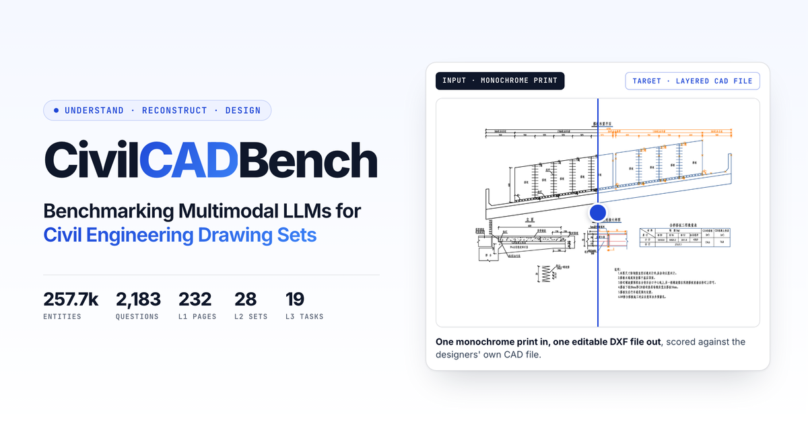
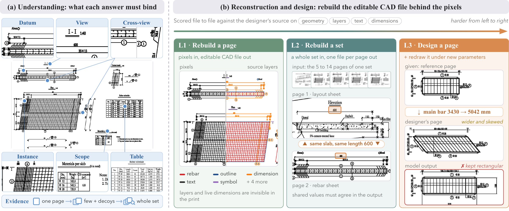

<p align="center">
  <a href="https://agenticivil.com/civilcadbench/zh">
    
  </a>
</p>

<h3 align="center">
  面向土木工程图纸集的多模态大模型基准：理解、重建与设计
</h3>

<p align="center">
  <a href="https://agenticivil.com/civilcadbench/zh"></a>
  <a href="https://agenticivil.com/civilcadbench/zh#results"></a>
  <a href="https://agenticivil.com/civilcadbench/sample/zh"></a>
  <a href="https://huggingface.co/datasets/AgentiCivil/CivilCADBench"></a>
  <a href="https://arxiv.org/abs/2611.28853"></a>
</p>

<p align="center">
  <a href="README.md">English</a> | <b>简体中文</b>
</p>

打印出来的图纸只有线条和文字，图层、尺寸标注实体，以及每个数值对应哪个对象，都只保存在设计人员的 CAD 文件里。CivilCADBench
用真实的土木工程图纸集，考察模型能把这些信息还原多少，共有理解、重建和设计三项任务，难度逐级上升。

<p align="center">
  
</p>
<p align="center"><sub><b>(a)</b> 理解：每道题都要判断图上的数值属于哪个对象。<b>(b)</b> 重建与设计：模型交回一个可编辑的 CAD 文件（DXF）。</sub></p>

<table>
  <thead>
    <tr>
      <th width="13%"></th>
      <th width="29%">理解</th>
      <th width="29%">重建（L1、L2）</th>
      <th width="29%">设计（L3）</th>
    </tr>
  </thead>
  <tbody>
    <tr>
      <th align="left">输入</th>
      <td>单页、多页或整套图纸的页面图像，加一道题</td>
      <td>单页（L1）或整套图纸（L2）的黑白打印图</td>
      <td>一张参考页及其 CAD 文件，加同套其他页</td>
    </tr>
    <tr>
      <th align="left">输出</th>
      <td>全部正确选项</td>
      <td>每页一个分图层的 DXF 文件</td>
      <td>一张新图的 DXF 文件</td>
    </tr>
    <tr>
      <th align="left">规模</th>
      <td>1,800 + 383 道题</td>
      <td>232 页 / 28 套</td>
      <td>19 个任务</td>
    </tr>
    <tr>
      <th align="left">评分方式</th>
      <td>完全匹配</td>
      <td>与设计人员的原始 CAD 文件逐点比对的 F1</td>
      <td>应当改动的数值的召回率</td>
    </tr>
  </tbody>
</table>

所有得分都由确定性的程序算出，不使用大模型裁判。

## 快速开始

需要 Python 3.12 或更高版本。重建和设计任务还需要 Docker。

```bash
git clone https://github.com/AgentiCivil/CivilCADBench
cd CivilCADBench
pip install -e .
ccb selfcheck     # 检查安装：把真值当作输出来评分，应得满分
ccb download      # 从 Hugging Face 下载完整基准：约 5.7 GB，13,000 个文件
```

仓库里带一份小的数据样例，在 `data/` 目录。运行 `ccb download` 之前，所有命令都在这份样例上运行，可以先用它把下面的步骤试一遍；
下载之后，所有命令都改用完整基准。`ccb` 每次都会打印当前用的是哪一份。

## 在理解任务上评测模型

`ccb run understanding` 把每道题发给一个兼容 OpenAI 的接口，给回答评分，并打印准确率。

```bash
export OPENAI_API_KEY=...
ccb run understanding --tier all --model <model> --base-url https://<host>/v1 --out runs/<name>
```

| 档位 | 模型拿到什么 | 怎么作答 |
|---|---|---|
| `single`（单页） | 一页图和一道题 | 一轮作答 |
| `few`（多页） | 这道题要用到的几页，和同一套图里相似的页混在一起 | 一轮作答 |
| `full`（整套） | 一整套图 | 多轮作答：用 `view_page` 工具自己翻页，可以用 `calculate` 做计算 |

中断的运行可以用同一条命令接着跑，已完成的请求会保留。`--limit 20` 只回答每个档位的前 20 个请求，适合先试一下。
`--extra '{"reasoning_effort": "high"}'` 可以给每个请求加上额外字段。

`full` 档位的每道题默认最多 16 轮、看图 24 次、生成 65,536 个 token。模型放大看图时，`ccb` 是从发布的页面图片上裁剪，
而我们的实验是从矢量图纸重新渲染的。因此这里放大后的细节更少，`ccb` 得到的整套理解准确率不能和结果表直接比较。

## 在重建和设计任务上评测智能体

`ccb run agent` 为每个任务建一个工作目录，在里面启动一个编程智能体，再给它交付的 DXF 文件评分。每个智能体都在容器里运行，
只能访问模型接口。先构建两个镜像，只需一次：

```bash
cd examples/docker
cp allowlist.example allowlist      # 每行一个允许访问的主机：你的模型接口
docker build -t cadbench/proxy -f proxy.Dockerfile .
docker build -t cadbench/agent -f agent.Dockerfile .
cd ../..
```

如果访问 Docker Hub 或默认软件源较慢，可以用 `--build-arg` 指定基础镜像和镜像源，可用的参数写在两个 Dockerfile 的开头。

然后运行 Claude Code 或 Codex CLI：

```bash
ccb run agent --level all --agent claude-code --model <model> \
    --env-file model.env --out runs/<name>
ccb run agent --level all --agent codex --model <model> \
    --codex-home <folder> --out runs/<name>
```

`model.env` 里写智能体用的接口地址和密钥，例如 `ANTHROPIC_BASE_URL` 和 `ANTHROPIC_API_KEY`。`--codex-home` 是存放 Codex 的
`config.toml` 和 `auth.json` 的目录。这份 `config.toml` 里只保留模型相关的设置即可，容器只能访问模型接口。

评测别的智能体，就构建一个装有它的镜像，再把它的启动命令传进来。`ccb` 会在每个工作目录里运行一次：

```bash
ccb run agent --level all --model <model> --image <image> --env-file model.env \
    --agent-cmd 'my-agent --model {model} "$CCB_PROMPT"' --out runs/<name>
```

| 级别 | 任务 | 智能体交付 | 每个任务限时 |
|---|---|---|---|
| `L1` | 232 页 | 一个 DXF 文件 | 2 小时 |
| `L2` | 28 套，共 230 页 | 每页一个 DXF 文件 | 6 小时 |
| `L3` | 19 个设计任务 | 一个 DXF 文件 | 2 小时 |

工作目录里有任务说明、输入的打印图，以及一个按输入图的出图方式渲染 DXF 的工具。设计人员的 CAD 文件和评分程序都在工作目录之外。
`--tasks` 可以只跑列出的几个任务。`--local` 不用容器，直接在本机运行智能体，适合先试一下，但不能用于正式报告的结果。

## 得分

```bash
ccb report runs/<name>
```

这条命令按[榜单](https://agenticivil.com/civilcadbench/zh#results)的各列打印一行得分，均为 0 到 100 分。这一行下面会说明它覆盖了多少任务和请求，
以及这次运行是否符合评测协议。同一个运行目录可以既有理解任务的结果，也有智能体的结果，报告会一并给出。
每个任务的得分在 `runs/<name>/summary.json` 里。

## 用你自己的评测框架

`ccb run` 建立在三个基于文件的步骤上，你也可以直接调用它们：`ccb` 把输入写成文件，你的代码产出输出，`ccb` 再评分。

```bash
# 写出 requests.jsonl 和图片，不含答案
ccb export understanding --tier single --out requests/
# 读取回答文件，每行一个：{"id": ..., "response": ...}
ccb grade understanding --tier single responses.jsonl
```

```bash
# 每个任务写出一个目录，不含真值
ccb export workspace --level L1 --out runs/<name>
# 读取每个目录里的 output.dxf（L1、L3）或 output/page_NN.dxf（L2）
ccb score runs/<name>
```

文件格式和固定的提示词见 [`docs/PROTOCOL.md`](docs/PROTOCOL.md)。

## 可比结果的评测协议

- **工作目录**：每个任务一份全新的拷贝；每个任务、每个模型只跑一次；智能体只提交一次。
- **工作目录之外**：原始 CAD 文件、真值和评分程序。
- **推理档位**：所有模型均为 high。
- **网络**：除模型接口外全部断开；不提供网页搜索。
- **沙箱**：8 核 CPU、16 GB 内存、1024 个进程、非 root。
- **限时**：L1 和 L3 为 2 小时，L2 为 6 小时；到时即停，按工作目录里已有的文件评分。
- **重跑**：只在基础设施故障后重跑，不因得分低而重跑。
- **理解**：单页和多页一轮作答；整套理解由模型用工具自己翻页。

细则和完整的提示词见 [`docs/PROTOCOL.md`](docs/PROTOCOL.md)。

## 结果

<table>
  <thead>
    <tr>
      <th rowspan="2" align="left" width="26%">模型</th>
      <th colspan="3">重建</th>
      <th>设计</th>
      <th colspan="3">理解</th>
    </tr>
    <tr>
      <th align="right" nowrap >L1&nbsp;页面</th>
      <th align="right" nowrap >L1&nbsp;图层&nbsp;F1</th>
      <th align="right" nowrap >L2&nbsp;整套</th>
      <th align="right" nowrap >L3&nbsp;召回率</th>
      <th align="right" nowrap width="11%">单页</th>
      <th align="right" nowrap width="11%">多页</th>
      <th align="right" nowrap width="11%">整套</th>
    </tr>
  </thead>
  <tbody>
    <tr><td>GPT-6 Astra</td><td align="right"><b>91.2</b></td><td align="right">59.9</td><td align="right"><b>87.8</b></td><td align="right">47.9</td><td align="right"><b>93.3</b></td><td align="right"><b>95.3</b></td><td align="right"><b>94.5</b></td></tr>
    <tr><td>GPT-6.1 Sol</td><td align="right">90.4</td><td align="right">58.9</td><td align="right">85.9</td><td align="right"><b>49.1</b></td><td align="right">91.5</td><td align="right">92.2</td><td align="right">89.7</td></tr>
    <tr><td>GPT-5.6 Sol</td><td align="right">59.8</td><td align="right">40.8</td><td align="right">36.6</td><td align="right">40.3</td><td align="right">72.2</td><td align="right">75.5</td><td align="right">69.4</td></tr>
    <tr><td>DeepSeek-V4.1-Flash</td><td align="right">81.3</td><td align="right">63.2</td><td align="right">55.4</td><td align="right">37.8</td><td align="right">60.4</td><td align="right">63.8</td><td align="right">58.7</td></tr>
    <tr><td>GLM-5.3-Flash</td><td align="right">76.1</td><td align="right"><b>70.8</b></td><td align="right">47.2</td><td align="right">19.2</td><td align="right">57.4</td><td align="right">60.2</td><td align="right">52.8</td></tr>
    <tr><td>Qwen3.8-27B</td><td align="right">36.2</td><td align="right">30.1</td><td align="right">14.5</td><td align="right">6.3</td><td align="right">58.2</td><td align="right">61.4</td><td align="right">53.6</td></tr>
    <tr><td>Qwen3.5-9B</td><td align="right">5.6</td><td align="right">1.8</td><td align="right">0.0</td><td align="right">0.0</td><td align="right">34.3</td><td align="right">43.1</td><td align="right">8.2</td></tr>
  </tbody>
</table>

<sub>重建：L1 的页面得分和图层 F1，L2 的整套得分。设计：应当改动的数值的召回率。理解：单页、多页、整套三档的准确率。均为 0 到 100 分，每列最高值加粗。</sub>

在单页上，最好的模型几何 F1 达到 95.5，图层 F1 只有 59.9：线画对了位置，却常常放错图层。完整的各列结果和案例分析见
[榜单](https://agenticivil.com/civilcadbench/zh#results)。

## 提交结果

想让自己的模型或智能体列入[榜单](https://agenticivil.com/civilcadbench/zh#results)，请用 **Submit results** 表单提一个 issue。
表单需要填写运行条件和 `ccb report` 的输出，并附上原始输出：回答文件和去掉 `_logs/` 的运行目录，可以直接上传，也可以给下载链接。
我们会用这些输出重新评分，分数一致后列入榜单。

## 数据

<table>
  <thead>
    <tr>
      <th width="18%"></th>
      <th width="17%">单页题</th>
      <th width="26%">多页与整套的跨页题</th>
      <th width="13%">L1 页</th>
      <th width="13%">L2 套</th>
      <th width="13%">L3 任务</th>
    </tr>
  </thead>
  <tbody>
    <tr>
      <th align="left">本仓库</th>
      <td align="center">60</td>
      <td align="center">10 道，含 62 道子题</td>
      <td align="center">6</td>
      <td align="center">1（7 页）</td>
      <td align="center">1</td>
    </tr>
    <tr>
      <th align="left">完整基准</th>
      <td align="center">1,800</td>
      <td align="center">383 与 330</td>
      <td align="center">232</td>
      <td align="center">28</td>
      <td align="center">19</td>
    </tr>
  </tbody>
</table>

完整基准发布在 Hugging Face：[AgentiCivil/CivilCADBench](https://huggingface.co/datasets/AgentiCivil/CivilCADBench)，许可为 CC BY-NC 4.0。
用 `ccb download` 下载，默认放在 `~/.cache/civilcadbench`，也可以用 `--dir` 指定位置。如果数据已经放在别处，用 `--data <目录>` 或环境变量 `CCB_DATA` 指定。

图纸、题目和任务说明均为中文，与原始图纸集一致；
[数据样例页面](https://agenticivil.com/civilcadbench/sample/zh)在每道题旁给出了对照翻译。

- [`docs/PROTOCOL.md`](docs/PROTOCOL.md)：与模型或智能体交换的文件、提示词和规则
- [`docs/DATA.md`](docs/DATA.md)：目录结构，题目、子题和任务的文件格式，去标识处理
- [`docs/SCORING.md`](docs/SCORING.md)：各个评分程序、`ccb score` 的各列，以及页面评分程序的错误注入测试
- [`SAMPLING.md`](SAMPLING.md)：样例是怎么抽取的

以上文档为英文。

## 目录结构

```
civilcadbench/     ccb 命令行
code/              评分程序，与论文所用一致
examples/          模型与智能体的接入示例、容器沙箱
data/              数据样例
docs/              评测协议、数据格式、评分说明
index.html         数据样例的离线查看页面（依赖 viewer/ 和 data/）
results/           六页样例的错误注入得分
```

## 引用

论文见 [arXiv:2611.28853](https://arxiv.org/abs/2611.28853)。如果 CivilCADBench 对你的工作有帮助，欢迎引用：

```bibtex
@misc{zheng2026civilcadbench,
  title         = {CivilCADBench: Benchmarking Multimodal LLMs for Understanding,
                   Reconstructing, and Designing Civil Engineering Drawing Sets},
  author        = {Zelin Zheng and Difei Wu and Xinyan Liu and Minghong Chen and
                   Antoni B. Chan and Difan Zou},
  year          = {2026},
  eprint        = {2611.28853},
  archivePrefix = {arXiv},
  primaryClass  = {cs.CV},
  url           = {https://arxiv.org/abs/2611.28853}
}
```

## 许可

代码以 [MIT 许可](LICENSE)发布。数据（包括 `data/` 里的样例）以 CC BY-NC 4.0 发布。

## 联系

问题和缺陷请提 [issue](https://github.com/AgentiCivil/CivilCADBench/issues)。
