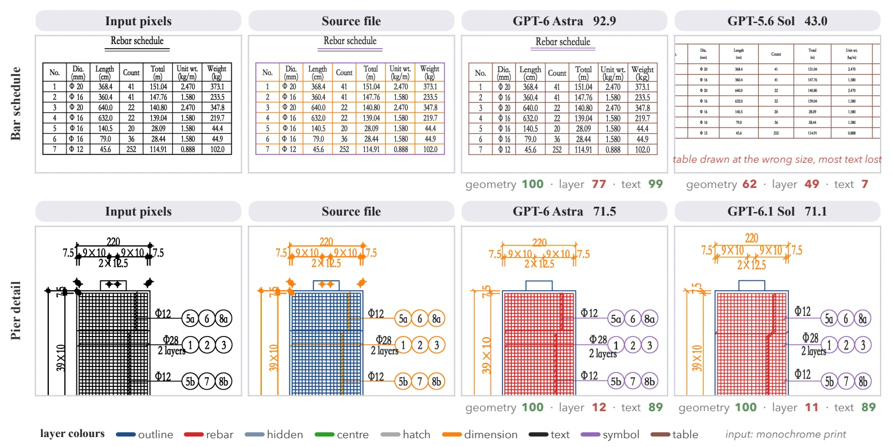
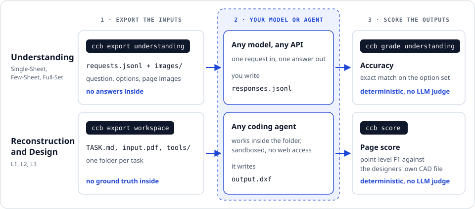

<p align="center">
  <a href="https://agenticivil.com/civilcadbench/zh">
    
  </a>
</p>

<h3 align="center">
  面向土木工程图纸集的多模态大模型基准：理解、重建与设计
</h3>

<p align="center">
  <a href="https://agenticivil.com/civilcadbench/zh"></a>
  <a href="https://agenticivil.com/civilcadbench/zh#results"></a>
  <a href="https://agenticivil.com/civilcadbench/sample/zh"></a>
  
  
</p>

<p align="center">
  <a href="README.md">English</a> | <b>简体中文</b>
</p>

图纸打印出来以后，线条还在，背后的文件却丢了：图层、尺寸标注实体，以及图上每个数值指的是哪个对象。CivilCADBench
用真实的土木工程图纸集，测量模型能从打印图中恢复多少，共三类任务，难度逐级上升。

<p align="center">
  
</p>
<p align="center"><sub><b>(a)</b> 理解：每个答案都要把图上的一个数值和它所属的对象对应起来。<b>(b)</b> 重建与设计：模型交回像素背后那个可编辑的 CAD 文件。</sub></p>

<table>
  <thead>
    <tr>
      <th width="13%"></th>
      <th width="29%">理解</th>
      <th width="29%">重建（L1、L2）</th>
      <th width="29%">设计（L3）</th>
    </tr>
  </thead>
  <tbody>
    <tr>
      <th align="left">输入</th>
      <td>单页、多页或整套图纸的页面图像，加一道题</td>
      <td>单页（L1）或整套图纸（L2）的黑白打印图</td>
      <td>一张参考页及其 CAD 文件，加同套其他页</td>
    </tr>
    <tr>
      <th align="left">输出</th>
      <td>全部正确选项</td>
      <td>每页一个分图层的 DXF 文件</td>
      <td>一张新图的 DXF 文件</td>
    </tr>
    <tr>
      <th align="left">规模</th>
      <td>1,800 + 383 道题</td>
      <td>232 页 / 28 套</td>
      <td>19 个任务</td>
    </tr>
    <tr>
      <th align="left">评分方式</th>
      <td>完全匹配</td>
      <td>与设计人员的原始 CAD 文件逐点比对的 F1</td>
      <td>应当改动的数值的召回率</td>
    </tr>
  </tbody>
</table>

所有得分都由确定性的程序算出，不使用大模型裁判。

## 结果

<table>
  <thead>
    <tr>
      <th rowspan="2" align="left" width="26%">模型</th>
      <th colspan="3">重建</th>
      <th>设计</th>
      <th colspan="3">理解</th>
    </tr>
    <tr>
      <th align="right" nowrap >L1&nbsp;页面</th>
      <th align="right" nowrap >L1&nbsp;图层&nbsp;F1</th>
      <th align="right" nowrap >L2&nbsp;整套</th>
      <th align="right" nowrap >L3&nbsp;召回率</th>
      <th align="right" nowrap width="11%">单页</th>
      <th align="right" nowrap width="11%">多页</th>
      <th align="right" nowrap width="11%">整套</th>
    </tr>
  </thead>
  <tbody>
    <tr><td>GPT-6 Astra</td><td align="right"><b>91.2</b></td><td align="right">59.9</td><td align="right"><b>87.8</b></td><td align="right">47.9</td><td align="right"><b>93.3</b></td><td align="right"><b>95.3</b></td><td align="right"><b>94.5</b></td></tr>
    <tr><td>GPT-6.1 Sol</td><td align="right">90.4</td><td align="right">58.9</td><td align="right">85.9</td><td align="right"><b>49.1</b></td><td align="right">91.5</td><td align="right">92.2</td><td align="right">89.7</td></tr>
    <tr><td>GPT-5.6 Sol</td><td align="right">59.8</td><td align="right">40.8</td><td align="right">36.6</td><td align="right">40.3</td><td align="right">72.2</td><td align="right">75.5</td><td align="right">69.4</td></tr>
    <tr><td>DeepSeek-V4.1-Flash</td><td align="right">81.3</td><td align="right">63.2</td><td align="right">55.4</td><td align="right">37.8</td><td align="right">60.4</td><td align="right">63.8</td><td align="right">58.7</td></tr>
    <tr><td>GLM-5.3-Flash</td><td align="right">76.1</td><td align="right"><b>70.8</b></td><td align="right">47.2</td><td align="right">19.2</td><td align="right">57.4</td><td align="right">60.2</td><td align="right">52.8</td></tr>
    <tr><td>Qwen3.8-27B</td><td align="right">36.2</td><td align="right">30.1</td><td align="right">14.5</td><td align="right">6.3</td><td align="right">58.2</td><td align="right">61.4</td><td align="right">53.6</td></tr>
    <tr><td>Qwen3.5-9B</td><td align="right">5.6</td><td align="right">1.8</td><td align="right">0.0</td><td align="right">0.0</td><td align="right">34.3</td><td align="right">43.1</td><td align="right">8.2</td></tr>
  </tbody>
</table>

<sub>重建：L1 的页面得分和图层 F1，L2 的整套得分。设计：应当改动的数值的召回率。理解：单页、多页、整套三档的准确率。均为 0 到 100 分，每列最高值加粗。</sub>

在单页上，最好的模型几何 F1 达到 95.5，图层 F1 只有 59.9：能把图描出来，却还原不出文件。完整的各列结果和案例分析见
[榜单](https://agenticivil.com/civilcadbench/zh#results)。

<p align="center">
  
</p>
<p align="center"><sub>两页 L1，颜色表示图层，模型名后的数字是页面得分。两个 GPT-6 模型把桥墩大样逐线画了出来（几何 F1 为 100），但只有少数线条落在原始文件的图层上（图层 F1 为 12 和 11）。</sub></p>

## 快速开始

```bash
git clone https://github.com/AgentiCivil/CivilCADBench
cd CivilCADBench
pip install -e .
```

需要 Python 3.12 或更高版本。仓库自带一份数据样例（60 道单页题、2 个多页图纸单元、6 页 L1、1 套 L2、1 个 L3 任务），克隆后下面的命令都能直接运行。
先用标准答案给自己评一次分，确认安装无误：

```bash
ccb selfcheck
# reconstruction  8/8 tasks at 100.0 with the ground truth as output
# understanding   132/132 gold answers pass, 132/132 perturbed answers fail
```

## 评测你自己的模型或智能体

CivilCADBench 不会调用你的模型。它把输入写成文件交给你，你把输出写成文件交回来，剩下的由评分程序完成。任何接口的模型、
任何智能体框架都能接入，只要能读写文件。

<p align="center">
  
</p>

### 理解：每道题一个回答

```bash
ccb export understanding --tier single --out requests/
```

`requests/requests.jsonl` 每行一个请求，不含答案（这里分行显示）：

```json
{
  "id": "SS-01",
  "kind": "item",
  "tier": "single",
  "system": "...",
  "prompt": "...",
  "images": ["images/SS-01.png"]
}
```

把每个请求发给你的模型，再把模型最后输出的文字写进 `responses.jsonl`：

```json
{"id": "SS-01", "response": "... 答案：A,C"}
```

```bash
ccb grade understanding --tier single responses.jsonl
# 输出 JSON：题数、作答数、答对数、准确率，以及按绑定类型的准确率
```

`--tier` 可取 `single`（单页）、`few`（多页）或 `full`（整套）。中间这一步，
[`examples/openai_compatible.py`](examples/openai_compatible.py) 已经为所有兼容 OpenAI 的接口写好；换成别的接口，只需替换其中一个函数。

### 重建与设计：每个任务一个工作目录

```bash
ccb export workspace --level L1 --out runs/my-agent
```

每个任务生成一个目录，里面只有智能体可以看到的文件：

```
runs/my-agent/L1-easy-01/
  TASK.md            任务说明：坐标约定、九个图层、要交付什么
  input.pdf          黑白打印图
  tools/             render_preview.py，按输入图的出图方式渲染 DXF
```

在目录里启动你的智能体，提示词用 [`docs/PROTOCOL.md`](docs/PROTOCOL.md) 里的固定提示词。它需要交付 `output.dxf`（L1、L3）
或 `output/page_NN.dxf`（L2）。然后给整次运行评分：

```bash
ccb score runs/my-agent
# 写出 runs/my-agent/summary.json：页面得分，几何 / 图层 / 文字 / 标注 F1，
# 共享值召回率（L2），设计召回率（L3）
```

没有交出有效文件的任务记 0 分。[`examples/`](examples) 里有 Codex CLI 的启动脚本，以及一套容器启动脚本（支持 Codex CLI 和
Claude Code），它会断开网络并施加下面的限制。

### 可比结果的评测协议

- **工作目录**：每个任务一份全新的拷贝；每个任务、每个模型只跑一次；智能体只提交一次。
- **工作目录之外**：原始 CAD 文件、真值和评分程序。
- **推理档位**：所有模型均为 high。
- **网络**：除模型接口外全部断开；不提供网页搜索。
- **沙箱**：8 核 CPU、16 GB 内存、1024 个进程、非 root。
- **限时**：L1 和 L3 为 2 小时，L2 为 6 小时；到时即停，按工作目录里已有的文件评分。
- **重跑**：只在基础设施故障后重跑，不因得分低而重跑。
- **理解**：单页和多页一轮作答；整套理解由模型用工具自己翻页。

细则和完整的提示词见 [`docs/PROTOCOL.md`](docs/PROTOCOL.md)。

## 数据

<table>
  <thead>
    <tr>
      <th width="18%"></th>
      <th width="17%">单页题</th>
      <th width="26%">多页与整套的跨页题</th>
      <th width="13%">L1 页</th>
      <th width="13%">L2 套</th>
      <th width="13%">L3 任务</th>
    </tr>
  </thead>
  <tbody>
    <tr>
      <th align="left">本仓库</th>
      <td align="center">60</td>
      <td align="center">10 道，含 62 道子题</td>
      <td align="center">6</td>
      <td align="center">1（7 页）</td>
      <td align="center">1</td>
    </tr>
    <tr>
      <th align="left">完整基准</th>
      <td align="center">1,800</td>
      <td align="center">383 与 330</td>
      <td align="center">232</td>
      <td align="center">28</td>
      <td align="center">19</td>
    </tr>
  </tbody>
</table>

完整基准将发布在 Hugging Face。图纸、题目和任务说明均为中文，与原始图纸集一致；
[数据样例页面](https://agenticivil.com/civilcadbench/sample/zh)在每道题旁给出了对照翻译。

- [`docs/PROTOCOL.md`](docs/PROTOCOL.md)：与模型或智能体交换的文件、提示词和规则
- [`docs/DATA.md`](docs/DATA.md)：目录结构，题目、子题和任务的文件格式，去标识处理
- [`docs/SCORING.md`](docs/SCORING.md)：各个评分程序、`ccb score` 的各列，以及页面评分程序的错误注入测试
- [`SAMPLING.md`](SAMPLING.md)：样例是怎么抽取的

以上文档为英文。

## 目录结构

```
civilcadbench/     ccb 命令行
code/              评分程序，与论文所用一致
examples/          模型与智能体的接入示例、容器沙箱
data/              数据样例
docs/              评测协议、数据格式、评分说明
index.html         数据样例的离线查看页面（依赖 viewer/ 和 data/）
results/           六页样例的错误注入得分
```

## 引用

引用信息将随论文一并补充。

## 联系

问题和缺陷请提 [issue](https://github.com/AgentiCivil/CivilCADBench/issues)。
